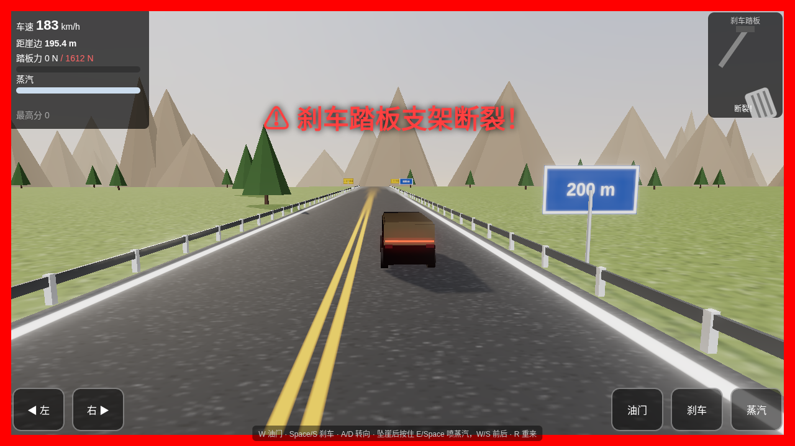

# 尊界 V800 悬崖刹车游戏（网友恶搞）

这是一个**粉丝自制的恶搞小游戏**，灵感来自懂车帝刹车测试的相关新闻（测试中刹车踏板支架断裂）。**非官方作品**，与尊界/华为/江淮及懂车帝均无关，车辆外形为推测建模。

在线游玩：https://mr-funny.github.io/v800-brake-game/

## 玩法
车辆在高原公路上自动加速冲向悬崖，停得离悬崖越近分越高。踏板力达到 1612 N 必断，也可能提前断裂；断裂后冲下峡谷，用蒸汽推进飞回公路并平稳着陆可得高分。

## 操作
- 空格 / S：刹车
- E / 空格（踏板断裂后）：喷射蒸汽上升
- R 键重新开始

基于 Three.js 构建。
